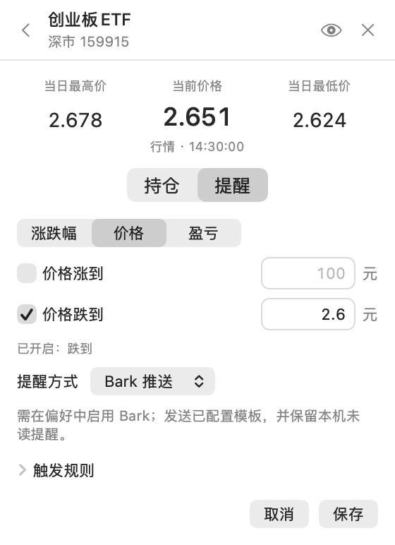
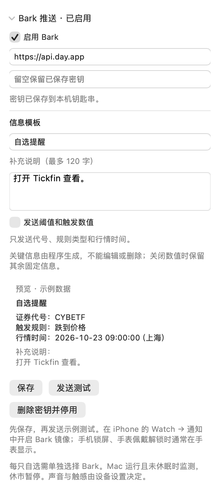
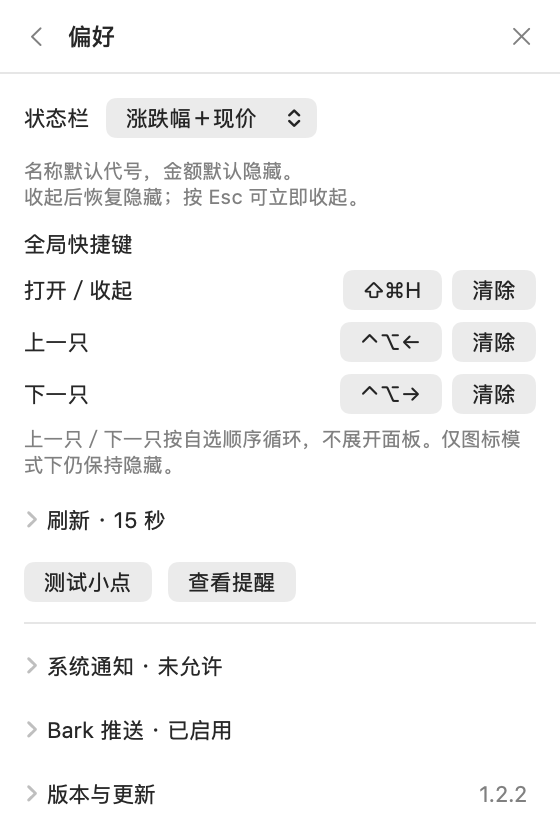

# Tickfin


[](https://github.com/ZeroClian/stockbar/actions/workflows/ci.yml)
[](https://github.com/ZeroClian/stockbar/releases/latest)
[](LICENSE)

**低调看行情，及时收提醒。** 原生 macOS 状态栏 A 股与 ETF 工具，280pt 小面板，默认隐藏名称和持仓金额。

**[下载安装](https://github.com/ZeroClian/stockbar/releases/latest) · [使用指南](docs/USAGE.md) · [更新日志](CHANGELOG.md) · [反馈问题](https://github.com/ZeroClian/stockbar/issues)**

## 界面

<table>
<tr><th>自选速览</th><th>持仓盈亏 · 主动显示</th><th>价格与提醒</th></tr>
<tr>
<td valign="top"></td>
<td valign="top"></td>
<td valign="top"></td>
</tr>
</table>

当前 v1.2.2 原生 SwiftUI 视图，使用隔离的示例数据；并非实时行情或真实持仓。

## 能做什么

| 功能 | 说明 |
| --- | --- |
| **A 股与 ETF** | 沪深北 A 股（含创业板、科创板）及沪深场内 ETF；代码 / 拼音简写搜索，最多 5 个候选，点 `＋` 添加。 |
| **状态栏速览** | 仅图标、仅涨跌幅、涨跌幅＋现价三种模式，例如 `+3.00% · 103.00`；股票价格两位、ETF 三位小数。 |
| **隐私与持仓** | 默认拼音代号，可自行修改；名称和持仓金额点眼睛才显示，收起即隐藏。支持成本、数量、当日估算与浮动盈亏，单项持仓可清空。 |
| **三类提醒** | 涨跌幅、到达价格、持仓浮动盈亏（金额 / 百分比）；可选静默小点、macOS 通知或 Bark 推送。 |
| **手机与手表** | Bark 可编辑标题和补充说明，默认固定信息只发代号、规则和时间；通过 iPhone 通知镜像送达 Apple Watch。 |
| **快捷操作** | 自选排序、图钉切换关注项；自定义打开 / 收起、上一只 / 下一只全局快捷键。 |
| **后台监测与更新** | 5–300 秒刷新，休市暂停、开市恢复；收起面板仍监测。应用内下载更新、原位替换重启，成功后清理旧包。 |

**v1.2.2 新增**：Bark 隐私通知与“涨跌幅＋现价”组合显示。[版本说明](docs/releases/v1.2.2.md)

<details>
<summary>查看 Bark 模板与状态栏设置</summary>

<table><tr><th>Bark 设置 · 原生组件展开</th><th>状态栏与快捷键</th></tr><tr>
<td valign="top"></td>
<td valign="top"></td>
</tr></table>

Bark 图为偏好页组件的完整展开视图；实际小面板可滚动。[配置手机与手表](docs/INSTALL.md#bark-手机与手表通知)

</details>

## 安装与使用

**Apple Silicon（M 系列芯片）· macOS 13+ 部署目标。** 当前仅提供 arm64 安装包，最低系统版本尚未实机验收。

1. 下载 [最新 Release](https://github.com/ZeroClian/stockbar/releases/latest) 的 DMG，将 **Tickfin** 拖入 **Applications**。
2. 弹出 DMG，从应用程序打开；点击菜单栏鱼形 K 线标记，点 `＋` 添加股票或 ETF。
3. 点击自选项录入持仓或设置提醒；偏好页选择状态栏模式、快捷键、刷新间隔和 Bark。

从 v1.2.1 起，可在 **偏好 → 版本与更新 → 检查更新 → 立即更新** 升级。应用仅在点击后安装；请保留固定位置的一个副本。

安装包采用 ad-hoc 签名，尚未 Apple 签名 / 公证。首次打开被阻止时，请按[安装指南](docs/INSTALL.md#首次打开被阻止)核对来源并操作。

## 使用边界与隐私

- 关闭面板仍监测，**Mac 必须运行且未休眠**。交易日历覆盖 2026 年；超出范围暂停并提示更新。提醒按间隔采样、每条规则每日一次，可能错过短暂触达。
- 行情与搜索使用腾讯公开接口，可能延迟或中断。仅展示行情，不提供交易；当日盈亏是按当前持仓估算，计算口径见[使用指南](docs/USAGE.md#计算口径)。
- 无需账号，不接入券商；持仓保存在本机未加密文件。Bark 密钥存于钥匙串；启用推送后，通知内容经 Bark 与 Apple 推送服务传送。默认不发价格或盈亏，详情见[数据与隐私](docs/USAGE.md#数据与隐私)。
- Apple Watch 接收取决于 iPhone / 手表通知设置；尚未完成真实手表端验收，服务接收成功不等于手表已显示。

## 开发与贡献

需要 macOS、Swift 6+（Xcode 16+ 或相应 Command Line Tools），无第三方 Swift 包依赖。

```bash
git clone https://github.com/ZeroClian/stockbar.git
cd stockbar
bash scripts/test.sh
# 先退出 Tickfin，安装到固定位置 /Applications/Tickfin.app
bash scripts/install-local.sh
```

[贡献指南](CONTRIBUTING.md) · [验证范围](docs/VALIDATION.md) · [发布流程](docs/RELEASING.md) · [安全反馈](SECURITY.md)

源码按 [MIT](LICENSE) 开放。交互方向参考 [Fishing Funds](https://github.com/1zilc/fishing-funds)，本项目独立实现，未复制其源码。
