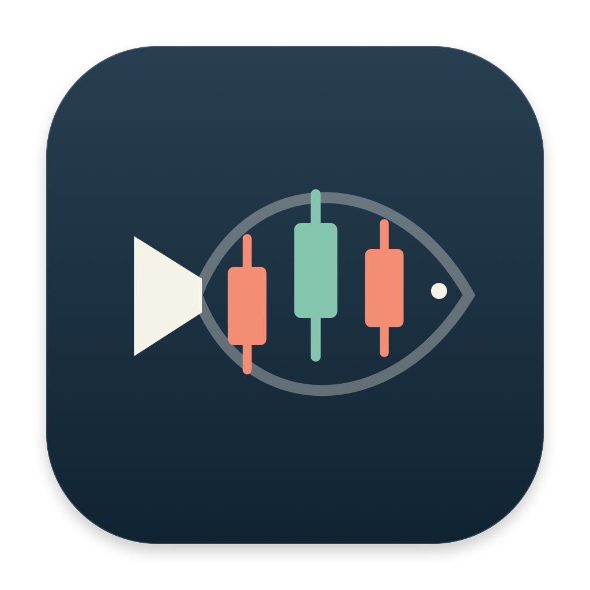
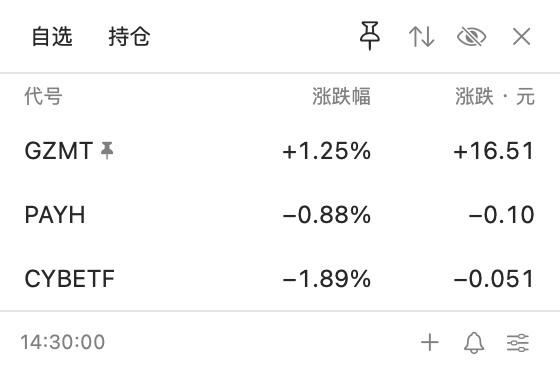
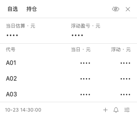
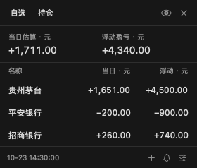

# Tickfin



[](https://github.com/ZeroClian/stockbar/actions/workflows/ci.yml)
[](https://github.com/ZeroClian/stockbar/releases/latest)
[](LICENSE)

一个低调的原生 macOS A 股与 ETF 状态栏工具。看涨跌、记持仓、设提醒，不需要打开行情大窗口。

**[下载安装](https://github.com/ZeroClian/stockbar/releases/latest) · [安装指南](docs/INSTALL.md) · [更新日志](CHANGELOG.md) · [反馈问题](https://github.com/ZeroClian/stockbar/issues)**

**v1.2.1** 新增沪深场内 ETF、代码 / 拼音搜索、价格与持仓盈亏提醒、上一只 / 下一只全局快捷键，以及下载、替换、重启和清理旧包的一键更新。[查看本版说明](docs/releases/v1.2.1.md)。

## 界面

<table><tr><th>自选速览</th><th>默认隐藏持仓</th><th>主动显示持仓 · 深色</th></tr><tr>
<td></td>
<td></td>
<td></td>
</tr></table>

图片为 v1.2.0 的实际 SwiftUI 视图，展示整体风格；使用示例数据，不代表当前行情。v1.2.1 的新增操作见下文。

## 功能

- **280pt 小面板**：单色数值，正负号区分涨跌，无分时图；默认状态栏仅显示单色鱼形 K 线标记。
- **沪深北 A 股**：通过代码或拼音首字母搜索添加，包含创业板 `300750` / `301269`、科创板 `688981`。
- **场内 ETF**：支持沪深交易所 ETF，例如 `510300`、`159915`、`588000`、`518880`、`513100`；包括在沪深上市的跨境、债券及货币 ETF。展示二级市场成交行情，不展示基金净值或估值；不支持 LOF、场外基金、指数及港美市场直接上市的 ETF。
- **隐私显示**：稳定可编辑代号（默认拼音首字母，如 `GZMT`、`NDSD`）；名称、股数、成本及持仓盈亏默认隐藏，点击眼睛显示，收起后复位。
- **持仓盈亏**：录入当前股数和平均成本，查看逐只及合计的当日估算、浮动盈亏。
- **涨跌幅、到价与持仓盈亏提醒**：默认静默小点，不申请通知权限、无横幅、无声音；每只股票可主动选择系统通知。
- **本地保存**：不需要账号，不接入券商，不上传持仓；支持本地行情缓存。
- **交易时段刷新**：5–300 秒自定义间隔，默认 15 秒；休市暂停，开市恢复，关闭面板不停止提醒。

不提供交易下单、中文名称搜索或开机启动设置。支持拼音搜索及用户点击后自动下载安装更新。仅供个人查看，行情可能延迟或中断，请以券商实际数据为准。

## 安装与开始使用

当前提供 **Apple Silicon / arm64** 的 DMG 和 ZIP。部署目标 macOS 13+，已在开发机验证；macOS 13 与 Intel 尚未实机验证，不提供 Intel 安装包。

从 v1.1.0「自选股」升级时，先退出并移走旧应用副本，再安装 Tickfin。原有持仓与设置保留，无需搬迁数据。

1. 从 [最新 Release](https://github.com/ZeroClian/stockbar/releases/latest) 下载 `Tickfin-1.2.1-arm64.dmg`。
2. 打开磁盘映像，将「Tickfin」拖入 `Applications`，弹出映像，再从应用程序打开。
3. 点击菜单栏的 **鱼形 K 线标记**。应用没有 Dock 图标，默认不会自动展开。
4. 点底部 `＋` 添加股票，点股票行编辑，点眼睛显示真实名称与持仓。
5. 在该股票的「提醒」页设置阈值；铃铛查看未读提醒，偏好页可测试小点。

当前是本地 **ad-hoc 签名，未做 Apple Developer ID 签名或公证**。首次打开可能被 Gatekeeper 阻止，请按 [安装指南](docs/INSTALL.md)核对来源后操作；不要全局关闭系统安全检查。

## 提醒规则

上涨达到正阈值、下跌达到负阈值即可触发，不要求刚刚穿越阈值。相同股票、方向、阈值每天一次，重启保留记录；改阈值视为新规则。静默提醒将未读与去重记录一起保存，标记已读不会重触发；下一交易日的新提醒会清理以前的未读。

在上海时区交易日 09:30–11:30、13:00–15:00 内刷新（不含收盘端点），且报价为当日、不超过 180 秒的新行情时判断。**关闭面板仍持续监测，应用必须保持运行，电脑不能休眠。** 提醒按刷新间隔采样，可能错过两次采样之间短暂触达阈值的情况。

午休、收盘、周末和内置节假日停止自动及手动行情刷新，开市自动恢复；休市启动只读取上次行情缓存，无缓存时等待开市。手动添加股票时仍会查询接口验证代码，版本检查由用户单独触发。休眠、退出、旧行情、更新失败不触发提醒。

内置日历依据[上交所 2026 年休市公告](https://www.sse.com.cn/disclosure/announcement/general/c/c_20251222_10802507.shtml)，覆盖 2026 年，周末调休上班也不开市；不包含临时停市。超出已覆盖年份会暂停行情监测并显示“日历需更新”，需安装包含新年度日历的版本。旧版 v1.1.0 采用固定 15 秒轮询和新鲜行情过滤，不含该调度策略。

主动选择系统通知后，通知使用代号、无金额、无声音；横幅受通知权限和专注模式影响。系统通知提交成功后才保存去重记录，通知系统与本机文件之间不是跨系统原子事务。

## 操作入口

- **全局快捷键**：偏好 → 全局快捷键 → 点击设置，按组合键并松开后保存。默认未设置；支持至少两个修饰键（包含 ⌃ 或 ⌘）加字母、数字、空格或左右方向键，例如 ⌃⌥空格。
- **刷新间隔**：偏好 → 刷新 → 输入 5–300 秒整数 → 保存。
- **自选排序**：主页右上角上下箭头 → 点每行上移／下移，即时保存；持仓列表沿用自选顺序，代号不变。
- **快速切换状态栏股票**：主页右上角图钉 → 选择代号。保持原状态栏显示模式；如需看涨跌幅，到偏好将“仅图标”改为“仅涨跌幅”。
- **检查新版**：偏好 → 版本与更新 → 检查更新 → 立即更新。首次从 v1.2.0 升级需手动替换一次，此后支持应用内更新。

## 新增操作详解

**一键更新**：偏好 → 版本与更新 → 检查更新 → 立即更新。自动下载适配芯片的 GitHub 正式版 ZIP，核对 GitHub 资产 SHA-256、应用标识、版本、签名和架构后，在原安装位置替换并重启；新版启动确认后删除下载包、解压目录、助手和旧版本。失败时保留或恢复旧应用；仅当回滚本身失败时保留备份以便恢复。持仓与设置目录不参与替换。应用应安装于 `/Applications/Tickfin.app` 或 `~/Applications/Tickfin.app`，目录需要可写；缺少兼容包或校验信息的发布版会保留手动下载入口。应用同时只运行一个实例。

**价格与盈亏提醒**：点击自选项 → 提醒 → 选择“价格”或“盈亏”。价格支持涨到／跌到；盈亏按单项持仓的浮动盈亏计算，可选金额或百分比，亏损阈值填正数。例如成本 100 元、100 股，现价 110 元，浮动盈利为 1,000 元 / 10%，与当日涨跌无关。数量或成本为零时暂停盈亏判断；清空持仓会保留规则，重新录入后恢复判断。三类提醒可同时启用，达到或越过阈值即可触发，保存时已达标则在下一次有效行情触发。仍按每条规则每天一次去重，修改单位或阈值视为新规则；盈亏数值在未读提醒中默认隐藏，系统通知不含价格或盈亏金额。

**状态栏切换快捷键**：偏好 → 全局快捷键，分别设置“打开／收起”“上一只”“下一只”。新增两组默认未设置，可使用至少两个修饰键（含 ⌃ 或 ⌘）搭配 ← / →，也支持字母、数字和空格。按自选顺序循环切换并保存选中项，适用于股票和 ETF；不打开面板、不改变隐私模式。状态栏为“仅图标”时切换不会显示数值，需要时可改为“仅涨跌幅”。

添加页支持六位证券代码或拼音首字母（不区分大小写，如 `NDSD`、`GZMT`、`HS300`）。输入后自动搜索，优先完整匹配、其次前缀匹配，最多显示 5 条 A 股/ETF 结果，点击右侧“＋”添加；已添加项显示勾选，可连续添加后点击“完成”。搜索需要联网，输入内容会发送给腾讯搜索服务；完整证券代码仍通过行情服务直接查询验证。

单项编辑页的“持仓 / 提醒”切换栏上方，从左到右显示当日最高价、当前价格、当日最低价，当前价格字号略大。股票价格保留两位小数，ETF 保留三位；缺失价格显示“—”，下方注明行情时间，历史行情的高低价属于该行情日期。

- 默认代号取名称的拼音首字母，保留英文和数字，最多 8 个字符；重名自动加数字后缀，仍可手动修改。
- 旧版已分配的 `A01` 等编号会迁移为拼音代号，其他自定义代号保留。旧版未记录代号来源，手工设成已分配编号格式的代号也可能被识别为默认值；升级前可备份数据。新版本保存后不再重复迁移手工编号。
- 点击自选项 → 持仓 → **清空持仓** → 确认，仅把该项数量和成本归零，立即保存；自选、代号、提醒、状态栏关注及其他持仓不变。清空后该项仍在自选中。

## 计算口径

| 项目 | 计算方式 |
| --- | --- |
| 每股涨跌额 | 现价 − 昨收价 |
| 当日估算盈亏 | 每股涨跌额 × 当前持仓股数 |
| 浮动盈亏 | （现价 − 平均成本）× 当前持仓股数 |

平均成本可填写券商含费成本；不追踪日内交易、已卖出收益、分红或现金。缺少部分持仓行情时不展示不完整合计；旧行情会标记。金额使用 `Decimal` 计算。ETF 的“股数／每股”对应“份数／每份”；涨跌额显示三位小数，涨跌幅和持仓盈亏仍显示两位小数。沪深上市的跨境 ETF 也按沪深交易时段刷新。

## 数据与隐私

数据位于 `~/Library/Application Support/StockBar/state.json`，包含自选、代号、持仓、提醒及去重记录；本地文件未加密，界面遮罩不等于磁盘加密。应用将最近行情保存在同目录的 `quotes-cache.json`，缓存仅供展示，不触发提醒。更名后沿用 `StockBar` 数据目录，已有持仓和设置无需迁移。

行情通过 HTTPS 请求腾讯公开接口 `qt.gtimg.cn`，发送证券代码；拼音搜索通过 `smartbox.gtimg.cn` 发送输入的查询词。两者都不发送持仓数量或成本。服务提供方仍可获知网络请求信息。项目与腾讯、券商没有隶属关系，也不承诺接口长期可用。

备份、升级和卸载步骤见 [安装指南](docs/INSTALL.md)。损坏的数据文件不会被静默重置，应用会停止保存与提醒以保护原数据。

## 本地开发

需要 macOS、Swift 6+ 工具链（Xcode 16+ 或相应 Command Line Tools），测试使用 Swift Testing；生产没有第三方 Swift 包依赖。

```bash
git clone https://github.com/ZeroClian/stockbar.git
cd stockbar
bash scripts/test.sh
# 先退出正在运行的 Tickfin；固定安装到 /Applications/Tickfin.app
bash scripts/install-local.sh
```

请只从固定安装位置启动应用。不要从不同构建目录启动多份 `.app`，否则 Spotlight 可能显示多个入口。开发安装脚本使用非索引临时目录，安装成功后清理临时应用包。

```bash
# 生成 DMG、ZIP、SHA-256 清单；默认输出 dist，不启动构建副本
bash scripts/package-release.sh

# 只读真实行情检查，不读写持仓、不申请通知权限
/Applications/Tickfin.app/Contents/MacOS/StockBar --check-market
```

可通过 `TICKFIN_TEST_ROOT`、`TICKFIN_BUILD_ROOT`、`TICKFIN_APP_PATH`、`TICKFIN_RELEASE_DIR` 将缓存和产物放到仓库外；具体示例见 [发布流程](docs/RELEASING.md)。开发安装可设置 `TICKFIN_WORK_ROOT`（建议以 `.noindex` 结尾）。测试脚本使用 SwiftPM native 构建引擎，部分工具链会提示弃用或测试框架部署版本警告；生产应用不链接测试框架。

| 目录 | 内容 |
| --- | --- |
| `Sources/StockCore` | 证券代码、解析、金额与提醒规则、本地状态模型 |
| `Sources/StockBar` | SwiftUI 界面、AppKit 状态栏、行情及通知服务 |
| `Tests` | 核心规则与 AppStore 集成测试 |
| `Resources` | 应用元数据和图标 |
| `scripts` | 构建、测试、预览与安装包脚本 |

[贡献指南](CONTRIBUTING.md) · [验证范围](docs/VALIDATION.md) · [版本发布流程](docs/RELEASING.md) · [安全反馈](SECURITY.md)

## 开源与致谢

项目源码按 [MIT 许可证](LICENSE)开放。第三方服务、商标及系统资源的权利不因本许可证转移。

交互方向参考 [Fishing Funds](https://github.com/1zilc/fishing-funds)，本项目独立实现精简需求，未复制其源码。
